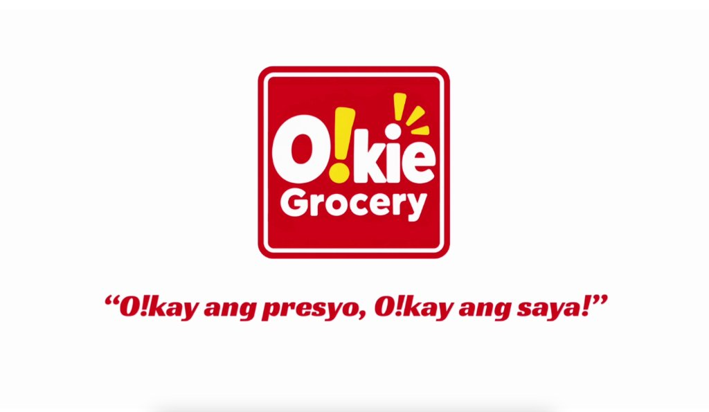
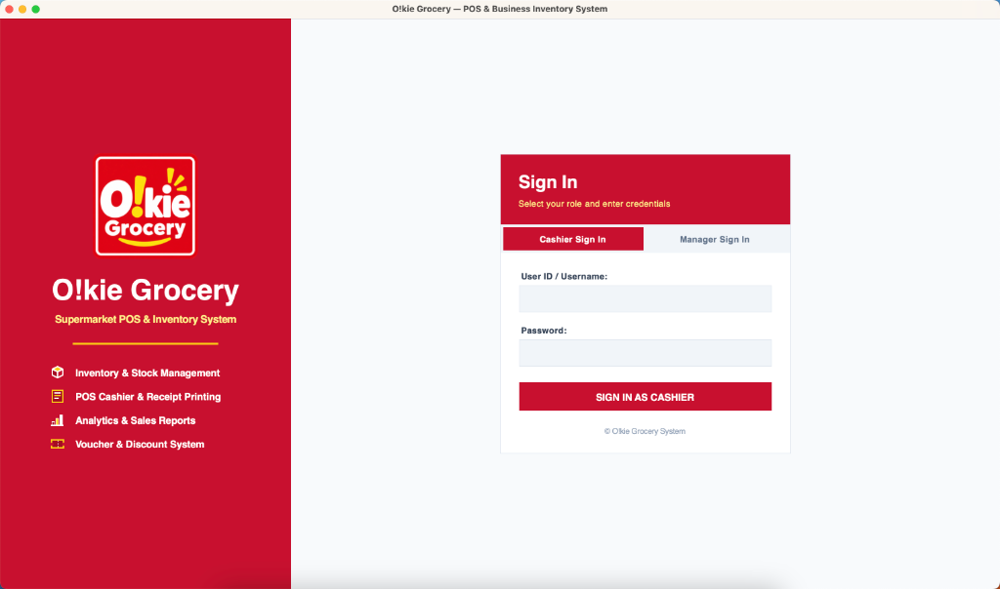
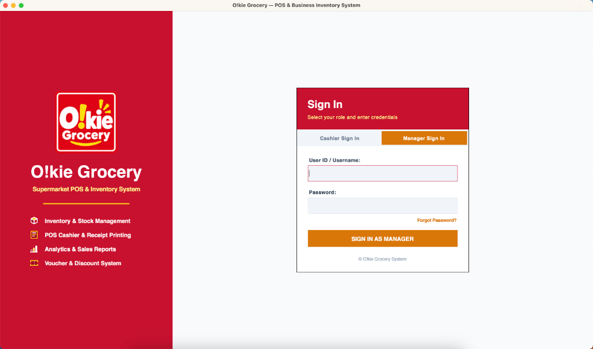
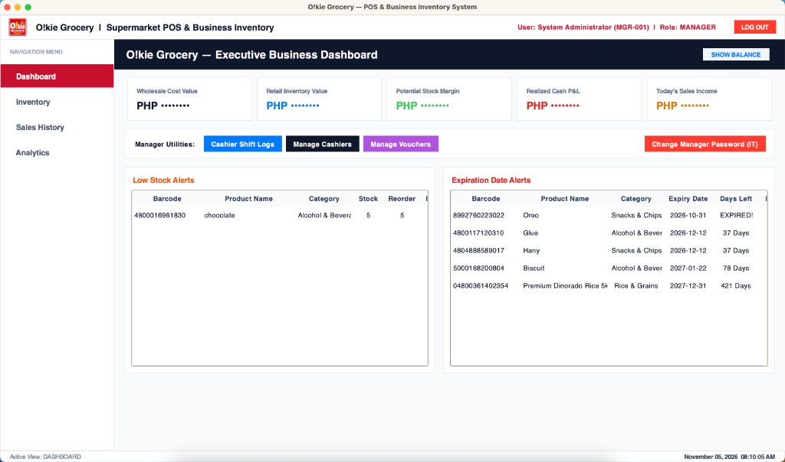
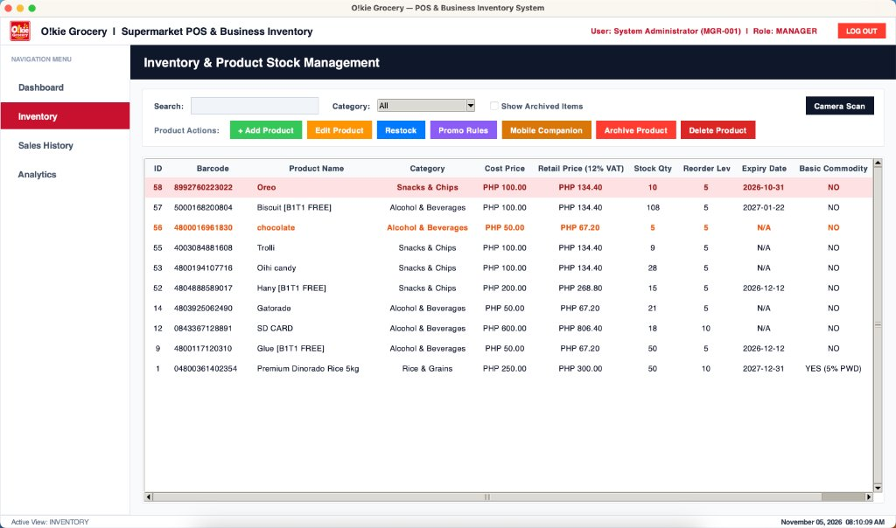
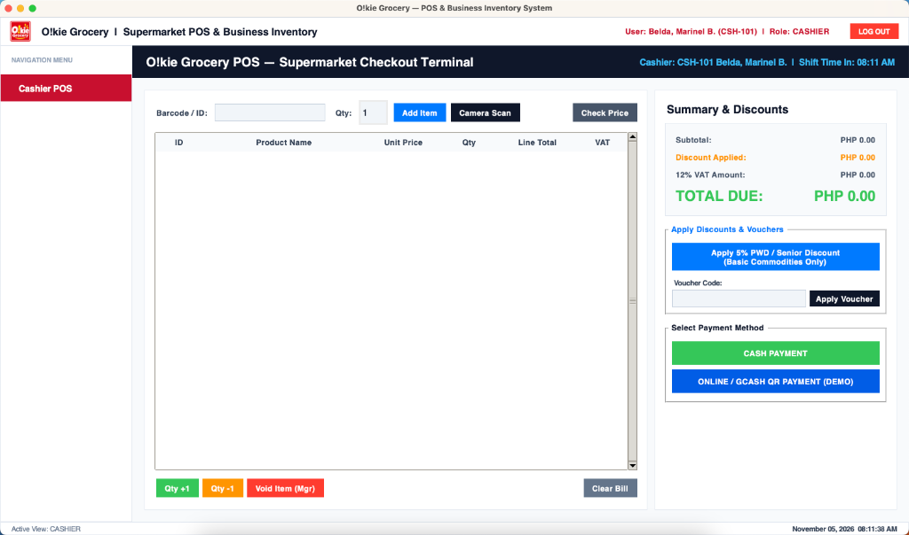
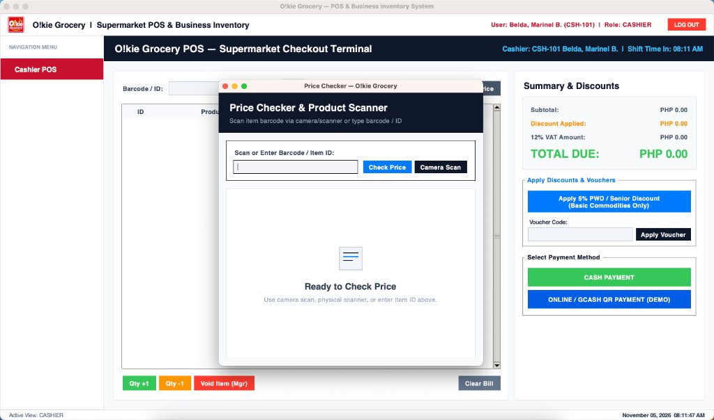
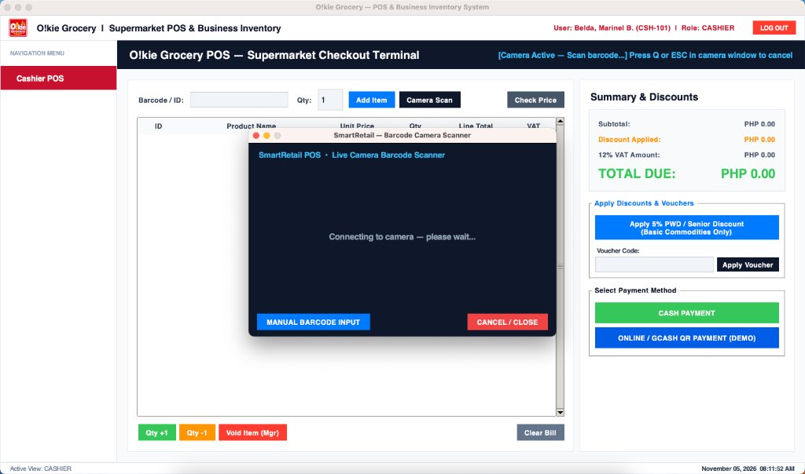

# O!kie Grocery: Supermarket Point of Sale (POS) and Business Inventory System

<p align="center">
  
</p>

## Overview

O!kie Grocery is an integrated desktop and local mobile supermarket Point of Sale (POS) and inventory management platform developed in Python. Designed for retail and grocery operations, the system automates cashier checkout workflows, tracks item shelf life and expiration dates, calculates statutory Philippine retail taxes (12% VAT and senior/PWD discounts), and synchronizes inventory updates in real time between desktop terminals and mobile companion devices over local Wi-Fi.

The platform uses a client-server architecture powered by Tkinter for the desktop graphical user interface, OpenCV and ZXing-CPP for computer vision barcode decoding, Flask for local network mobile services, and MySQL for relational transactional storage.

---

## System Architecture and Key Modules

### 1. Role-Based Access Control and Authentication
The system enforces strict role-based authorization to isolate operational cashier duties from managerial and financial functions.

* **Cashier Access**: Restricts user interaction exclusively to the checkout terminal, price checking utilities, and shift completion logs.
* **Manager Access**: Grants full administrative permissions, including stock inventory management, financial margin calculations, cashier shift audits, and promotional rule definitions.
* **Emergency Recovery**: Features a hardcoded administrative recovery mechanism for supervisor credential resets.

<p align="center">
  
  
</p>
<p align="center"><em>Figure 1: Cashier (Left) and Manager (Right) Role Authentication Interfaces</em></p>

---

### 2. Executive Business Dashboard
The manager dashboard provides store administrators with an immediate overview of retail performance, inventory valuation, and stock alerts.

* **Financial KPI Tracking**: Computes wholesale inventory cost, projected retail value, unrealized profit margins, realized cash profit/loss, and gross daily sales revenue.
* **Low Stock Alerts**: Automatically highlights products reaching or dropping below designated reorder threshold quantities.
* **Expiration Tracking**: Identifies products nearing expiration dates and flags expired items in real time to prevent regulatory non-compliance.
* **Staff Audit Utilities**: Includes direct shortcuts to cashier shift records, account provisioning, and promotional voucher configurations.

<p align="center">
  
</p>
<p align="center"><em>Figure 2: Executive Business Dashboard and Real-Time Operational Alerts</em></p>

---

### 3. Inventory and Product Stock Management
A centralized catalog supporting end-to-end merchandise management, category segmentation, wholesale cost evaluation, and regulatory tax compliance.

* **Automated Price and VAT Calculation**: Automatically computes the 12% Value Added Tax (VAT) and final retail selling price based on wholesale cost and customizable profit markup percentages.
* **Basic Commodity Exemptions**: Supports compliance with Philippine statutory law (RA 9994 / RA 10754), exempting basic grocery necessities from standard VAT when senior citizen or PWD discounts apply.
* **Lifecycle Management**: Provides dedicated functions for stock restocking, promotional rule assignments (e.g., Buy 1 Take 1 Free), product archiving, and permanent removal.

<p align="center">
  
</p>
<p align="center"><em>Figure 3: Product Inventory Catalog and Management Console</em></p>

---

### 4. Point of Sale (POS) Checkout Terminal
A streamlined transaction interface built for rapid, high-throughput retail checkout with support for multiple payment workflows and item lookups.

* **Transaction Processing**: Real-time line-item tabulation with dynamic subtotal, tax amount, and net balance calculations.
* **Discounts and Vouchers**: Integrated controls for statutory senior/PWD 5% basic commodity discounts and store-issued promotional vouchers.
* **Dual Payment Settlement**: Supports traditional physical cash tender with automatic change calculation, alongside an integrated local mock GCash QR payment gateway with real-time countdown timers.
* **Manager Voids**: Requires administrative supervisor override for item deletions to prevent point-of-sale fraud.

<p align="center">
  
</p>
<p align="center"><em>Figure 4: Cashier Supermarket Point of Sale Terminal</em></p>

---

### 5. Computer Vision Barcode Scanning and Price Verification
* **Integrated Hardware and Camera Support**: Compatible with standard physical USB barcode scanners and live laptop/webcam video feeds using OpenCV and ZXing-CPP.
* **Customer Price Verification**: Dedicated modal window allowing cashiers to quickly check item availability, unit prices, and active promotional rules without adding items to an active customer bill.

<p align="center">
  
  
</p>
<p align="center"><em>Figure 5: Price Checker Utility (Left) and Live Camera Barcode Scanner (Right)</em></p>

---

### 6. Mobile Inventory Companion
The desktop terminal embeds a lightweight background Flask HTTP server on the local area network (LAN). By scanning a dynamic pairing QR code on the desktop screen with a smartphone:
* Managers can use their phone's native camera as a wireless barcode reader in store aisles.
* Stock adjustments and product registrations executed on the phone automatically update the central MySQL database and trigger real-time UI refreshes on the desktop terminal without manual page reloads.

---

## Technical Specifications

| Component | Technology | Description |
| :--- | :--- | :--- |
| Programming Language | Python 3.10+ / 3.12 | Core application logic and procedural scripting |
| Desktop Interface | Tkinter / Ttk | Native desktop graphical interface with customized themed widgets |
| Web Application | Flask, HTML5, CSS3, JavaScript | Lightweight local network server for smartphone mobile companion |
| Relational Database | MySQL 8.0+ | Persistent relational storage for transactions, inventory, and users |
| Database Connector | mysql-connector-python | Thread-safe connection handling and parameterized query execution |
| Computer Vision | OpenCV (cv2) & ZXing-CPP | Real-time 1D/2D barcode recognition and camera video frame capture |
| Barcode & QR Generation | qrcode, Pillow | Image generation for pairing sessions and digital payment codes |
| Audio Feedback | Native platform audio / wav | Auditory feedback for successful and erroneous scan operations |

---

## Database Architecture

The persistence layer is structured around an interconnected relational schema defined in `db/setup.py`:

* `users`: Stores user credentials, hashed passwords, roles (`cashier`, `manager`), and operational status.
* `products`: Product catalog storing barcodes, item descriptions, wholesale costs, retail pricing, stock quantities, reorder points, and expiration dates.
* `sales`: Transaction headers tracking receipt serial numbers, cashier identification, payment types, discount deductions, tax amounts, and timestamps.
* `sale_items`: Detailed line-item breakdown for each finalized sales invoice.
* `cashier_shifts`: Audit log recording cashier login times, shift sales count, gross shift intake, and logout timestamps.
* `inventory_movements`: Immutable stock transaction ledger recording restock and adjustment events.
* `item_promotions`: Rules for special discounting, such as Buy 1 Take 1 deals.

Diagram assets are available in `assets/diagrams/`:
* `assets/diagrams/erd_diagram.png`: Entity-Relationship Diagram detailing primary and foreign key constraints.
* `assets/diagrams/flowchart_diagram.png`: End-to-end operational execution flowchart.

---

## Installation and Setup Guide

### Prerequisites
Ensure the target machine has the following installed:
1. **Python 3.10** or newer.
2. **MySQL Server 8.0+** (or an equivalent distribution such as XAMPP / MariaDB).
3. A functional webcam or connected USB barcode reader (optional for manual keyboard entry).

### Step 1: Clone the Repository
```bash
git clone https://github.com/annhutle99/okie-grocery-pos.git
cd okie-grocery-pos
```

### Step 2: Configure Virtual Environment
It is recommended to run the project inside an isolated virtual environment:

```bash
# macOS / Linux
python3 -m venv venv
source venv/bin/activate

# Windows (Command Prompt)
python -m venv venv
venv\Scripts\activate
```

### Step 3: Install Required Dependencies
```bash
pip install -r requirements.txt
```

### Step 4: Configure Database Connection
Review `db/connection.py` to ensure the host, port, username, and password align with your local MySQL installation:

```python
DB_CONFIG = {
    "host": "localhost",
    "user": "root",
    "password": "your_mysql_password",
    "database": "system_db",
    "autocommit": False,
}
```

### Step 5: Initialize the Database Schema
Execute the database initialization script to create tables, constraints, default users, and initial inventory records:

```bash
python db/setup.py
```

### Step 6: Launch the Application
```bash
python main.py
```
*(On macOS, you may also launch using the included execution script: `./run.sh`)*

---

## Default System Credentials

| Role | Username | Password | Purpose |
| :--- | :--- | :--- | :--- |
| Cashier | `cashier1` | `1234` | Point of Sale checkout and price checks |
| Cashier | `cashier2` | `1234` | Alternate cashier terminal account |
| Manager | `admin` | `admin123` | Full administrative, inventory, and analytics access |
| IT Override | `IT-ADMIN-9999` | N/A | Emergency administrative password recovery key |

---

## License

This software is developed and distributed for educational and commercial retail management evaluation. All rights reserved.
